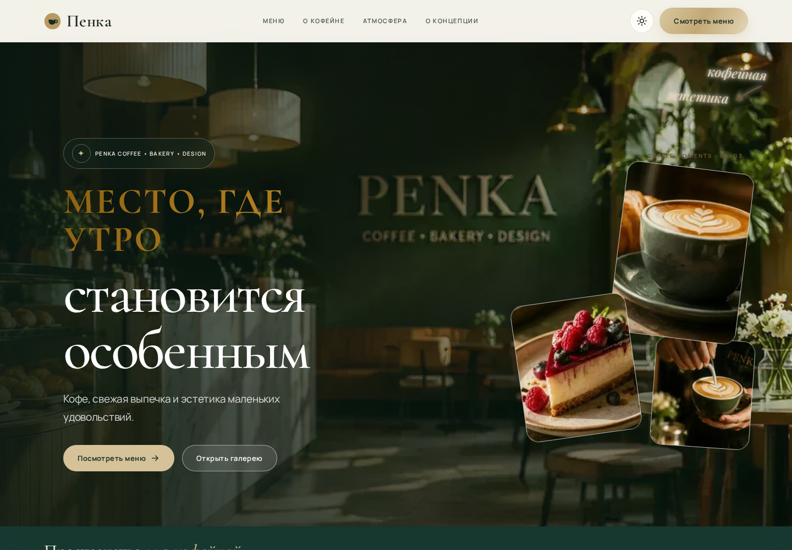
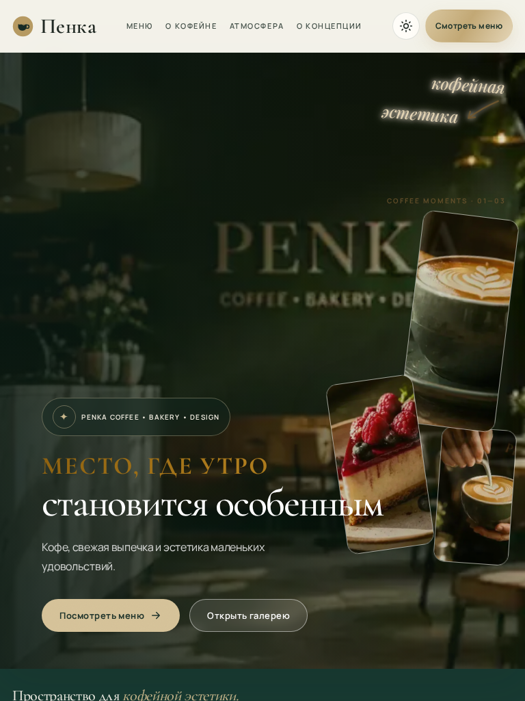
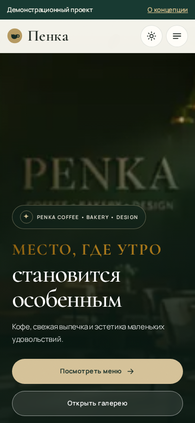

# PENKA — кейс разработки сайта кофейни

> Концептуальный проект для портфолио: дизайн и разработка адаптивного сайта вымышленной specialty coffee-кофейни.

**Демо:** https://marcostavar24633-cyber.github.io/Penka/  
**Репозиторий:** https://github.com/marcostavar24633-cyber/Penka

## 1. Идея и задача

PENKA — самостоятельная визуальная концепция сайта кофейни в эстетике quiet luxury. Задача проекта — показать, как с помощью выразительной типографики, продуманной композиции, фотографии и интерактивных деталей можно передать атмосферу бренда и сделать знакомство с меню удобным на любом устройстве.

Проект вымышленный и предназначен для демонстрации дизайна и разработки. Это не действующее заведение и не кейс реального бизнеса.

## 2. Визуальная концепция

- **Характер:** спокойный премиальный минимализм без визуального шума.
- **Палитра:** оттенки слоновой кости и молочного, глубокий лесной зелёный, кофейные нейтрали и шампань-золото.
- **Типографика:** выразительная антиква для заголовков в паре с нейтральным гротеском для интерфейса и длинного текста.
- **Образ:** кофейная культура, выпечка, детали приготовления и уютное пространство.
- **Композиция:** крупные фотографии, свободное пространство, редакционные текстовые блоки и мягкие карточки с округлыми формами.

Светлая тема задаёт основное настроение, тёмная предлагает альтернативный сценарий с глубоким фоном и золотистыми акцентами.

## 3. Структура и пользовательские сценарии

Сайт построен как одностраничная презентация:

1. Первый экран знакомит с визуальным образом PENKA.
2. Редакционные блоки раскрывают идею кофейной культуры и выпечки.
3. Интерактивное меню разделено на пять категорий: кофе, авторские напитки, чай, выпечка и десерты.
4. Галерея показывает детали концепции и открывает фотографии в полноэкранном просмотре.
5. Финальный блок возвращает пользователя к меню.

Ключевые действия доступны через навигацию, кнопки и мобильную панель быстрых переходов. Категории меню поддерживают клавиатурное управление, а галерея — переход между изображениями и возврат фокуса после закрытия.

## 4. Реализованные функции

- Адаптивная сетка и отдельные состояния интерфейса для мобильных, планшетов и широких экранов.
- Мобильное выдвижное меню с управлением клавиатурой и закрытием по Escape.
- Переключение светлой и тёмной темы с сохранением выбора.
- Меню с интерактивными вкладками и клавиатурной навигацией.
- Полноэкранная галерея с предыдущим/следующим изображением.
- Плавное появление блоков при прокрутке и деликатные интерактивные эффекты.
- Уважение системной настройки `prefers-reduced-motion`.
- Адаптивные изображения WebP с вариантами размеров и `srcset`.
- SEO-метаданные, Open Graph, canonical URL, sitemap.xml и robots.txt.
- Структурированные данные Schema.org для WebSite и WebPage — без ложного описания вымышленного заведения как реального LocalBusiness.

## 5. Технологии и архитектура

- Семантический HTML.
- CSS с переменными дизайн-системы, адаптивными правилами и темами.
- Vanilla JavaScript без тяжёлых UI-фреймворков.
- Локальные оптимизированные WebP-ресурсы.
- GitHub как система контроля версий.
- GitHub Pages как площадка публикации.
- GitHub Actions для автоматических проверок качества и Lighthouse-аудита.

Проект не требует отдельного backend-сервера, базы данных, платных API или сборщика для запуска. Это облегчает публикацию и сопровождение статического сайта.

## 6. Доступность и адаптивность

В интерфейсе предусмотрены семантические элементы, видимый фокус, подписи интерактивных элементов, клавиатурное управление вкладками и галереей, а также сценарии закрытия мобильной навигации. Анимации отключаются или сокращаются при включённой системной настройке уменьшения движения.

Автоматические браузерные проверки охватывают ширины 320, 360, 375, 390, 420, 768, 1024, 1440 и 1920 px. Проверяются основные интерактивные сценарии и отсутствие горизонтальной прокрутки.

## 7. Результаты технического аудита

По трём сохранённым отчётам Lighthouse (запуск GitHub Actions **43692580877**) получены следующие значения:

| Категория | Результаты |
|---|---:|
| Performance | 95–99 |
| Accessibility | 100 |
| Best Practices | 100 |
| SEO | 100 |

Дополнительные показатели в этих отчётах:
- First Contentful Paint: 1,8 с.
- Largest Contentful Paint: 1,8–2,8 с.
- Total Blocking Time: 0 мс.
- Cumulative Layout Shift: 0.

Это результаты конкретных автоматизированных прогонов, а не гарантия одинаковых показателей на каждом устройстве и при любом соединении. Отчёты и последующие проверки доступны во вкладке [GitHub Actions](https://github.com/marcostavar24633-cyber/Penka/actions).

## 8. Границы демонстрационного проекта

Чтобы не создавать ложного впечатления о действующем бизнесе, на сайте явно обозначен его концептуальный статус.

- Кофейня, название, меню и цены вымышлены.
- Фотографии созданы с помощью ИИ.
- Реальных адреса, телефона, отзывов, наград и точки продаж нет.
- Корзина, оплата и оформление реального заказа не реализованы.
- Конверсия, выручка и коммерческие результаты не заявляются.

## 10. Визуальная презентация

Ниже — реальные скриншоты опубликованной версии сайта, полученные автоматизированным запуском Chromium. Для каждого устройства сохранены первый экран и полная высота страницы.

| Desktop · 1440 px | Tablet · 768 px | Mobile · 390 px |
|---|---|---|
|  |  |  |

Полные страницы: [desktop](portfolio/screenshots/penka-desktop-full.png) · [tablet](portfolio/screenshots/penka-tablet-full.png) · [mobile](portfolio/screenshots/penka-mobile-full.png).

## 11. Итог

PENKA демонстрирует полный цикл создания статического коммерческого интерфейса: от визуальной концепции и структуры пользовательских сценариев до адаптивной реализации, доступности, SEO-настроек, автоматических проверок и публикации.

**Открыть проект:** https://marcostavar24633-cyber.github.io/Penka/
