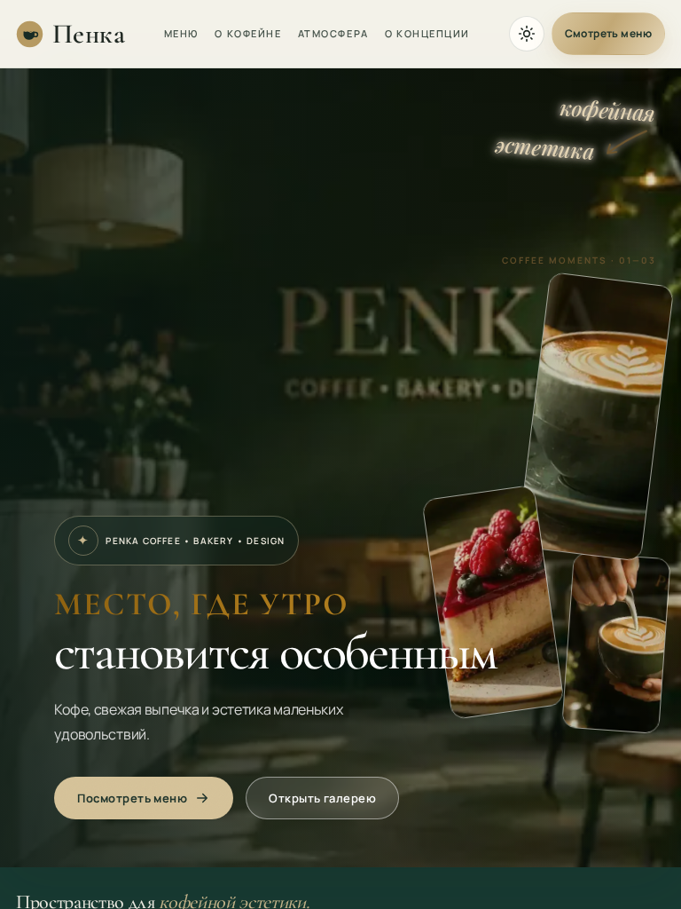
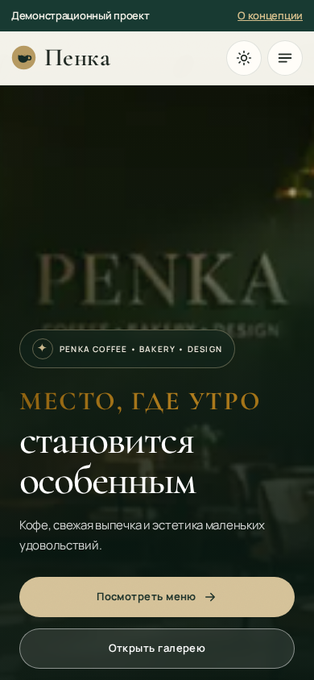

# PENKA — кейс для портфолио

**Проект:** концепция сайта specialty coffee-кофейни  
**Формат:** адаптивный одностраничный сайт  
**Роль:** концепция, UX/UI и фронтенд-реализация  
**Статус:** демонстрационный проект, не действующий бизнес

## Презентация

**[Открыть сайт PENKA](https://marcostavar24633-cyber.github.io/Penka/)** · **[Подробный технический кейс](CASE-STUDY.md)** · **[Исходный код](https://github.com/marcostavar24633-cyber/Penka)**

## Концепция

PENKA — визуальная концепция современной кофейни в эстетике quiet luxury. В основе — тёплая светлая палитра, глубокий лесной зелёный, шампань-золото, выразительная антиква, крупная фотография и свободная редакционная композиция.

Сайт знакомит посетителя с характером бренда, проводит через тематические блоки, интерактивное меню и галерею. Интерфейс адаптирован для телефонов, планшетов и широких экранов.

## Что реализовано

- Первый экран с фирменной подачей и ключевым переходом к меню.
- Редакционные блоки о кофейной культуре и выпечке.
- Меню с пятью интерактивными категориями.
- Галерея с полноэкранным просмотром, клавиатурной навигацией и возвратом фокуса.
- Светлая и тёмная темы с сохранением выбора.
- Адаптивная мобильная навигация и быстрые действия.
- Анимации с поддержкой системной настройки уменьшения движения.
- SEO-метаданные, Open Graph, canonical URL, sitemap.xml и robots.txt.
- Оптимизированные WebP-изображения и адаптивные варианты для разных экранов.

## Техническая реализация

Сайт создан на семантическом HTML, CSS и vanilla JavaScript. Нет тяжёлого UI-фреймворка, сборщика, отдельного backend-сервера или базы данных. Публикация выполняется через GitHub Pages, автоматические проверки — через GitHub Actions.

## Результаты проверок

В трёх сохранённых Lighthouse-прогонах (запуск [43692580877](https://github.com/marcostavar24633-cyber/Penka/actions/runs/43692580877)) зафиксированы:

| Метрика | Результат |
|---|---:|
| Performance | 95–99 |
| Accessibility | 100 |
| Best Practices | 100 |
| SEO | 100 |
| First Contentful Paint | 1,8 с |
| Largest Contentful Paint | 1,8–2,8 с |
| Total Blocking Time | 0 мс |
| Cumulative Layout Shift | 0 |

Значения относятся к указанным прогонам и могут отличаться при повторном измерении на другом устройстве или соединении. Актуальные автоматические проверки доступны в [GitHub Actions](https://github.com/marcostavar24633-cyber/Penka/actions).

## Короткое описание для карточки портфолио

Разработан концепт адаптивного сайта specialty coffee-кофейни PENKA. Продуманы визуальная система, пользовательские сценарии, интерактивное меню, фотогалерея, мобильная навигация, две цветовые темы и базовая SEO-структура. Проект прошёл автоматические проверки адаптивности и доступности; Lighthouse показал 100 баллов в категориях Accessibility, Best Practices и SEO в трёх сохранённых прогонах.

## Скриншоты для презентации

В репозитории настроен отдельный workflow [PENKA portfolio screenshots](https://github.com/marcostavar24633-cyber/Penka/actions/workflows/portfolio-screenshots.yml). После публикации он открывает живую версию сайта в Chromium и сохраняет настоящие скриншоты desktop (1440 px), tablet (768 px) и mobile (390 px): полный экран страницы и первый экран для каждого формата. Файлы загружаются как артефакт `penka-portfolio-screenshots` в запуске workflow и доступны для скачивания в течение 30 дней.

## Скриншоты опубликованной версии

Скриншоты автоматически сняты Chromium непосредственно с опубликованного сайта в трёх размерах экрана. В архиве находятся шесть PNG-файлов: полный экран и первый экран для каждого устройства.

- Desktop — 1440 px: `penka-desktop-full.png`, `penka-desktop-hero.png`
- Tablet — 768 px: `penka-tablet-full.png`, `penka-tablet-hero.png`
- Mobile — 390 px: `penka-mobile-full.png`, `penka-mobile-hero.png`

**[Скачать архив скриншотов в GitHub Actions](https://github.com/marcostavar24633-cyber/Penka/actions/runs/43698951727)** (артефакт хранится 30 дней с момента создания).

## Скриншоты интерфейса

Реальные кадры опубликованного сайта, снятые в Chromium при трёх размерах экрана. Полные версии страниц доступны в каталоге [portfolio/screenshots](portfolio/screenshots/).

| Desktop · 1440 px | Tablet · 768 px | Mobile · 390 px |
|---|---|---|
|  |  |  |

## Важно

PENKA — вымышленная кофейня и демонстрационный проект. Название, меню и цены условные; фотографии созданы с помощью ИИ. Реального адреса, телефона, режима работы, отзывов, точки продаж, онлайн-заказа, конверсии и коммерческих результатов нет. Эти данные не следует представлять как факты о действующем бизнесе.
