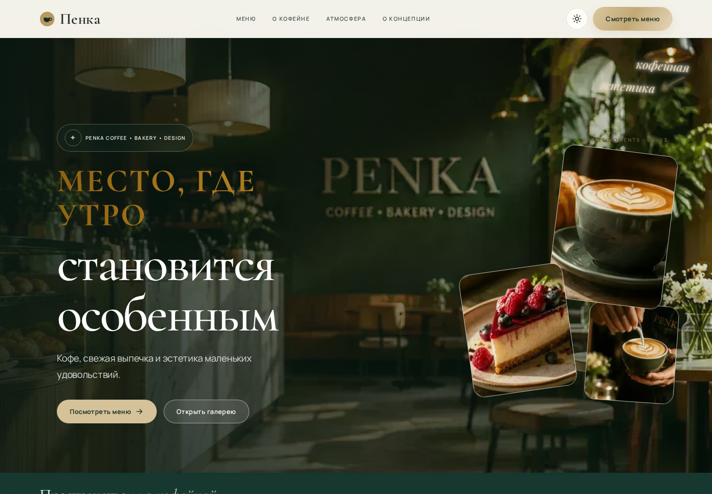
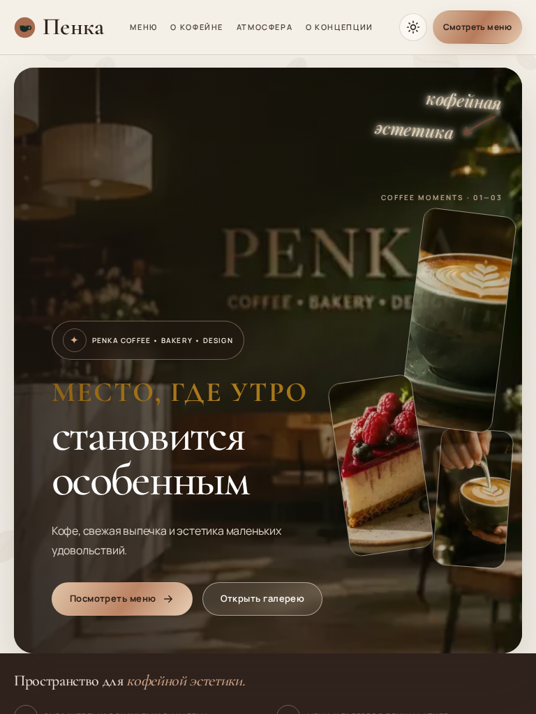
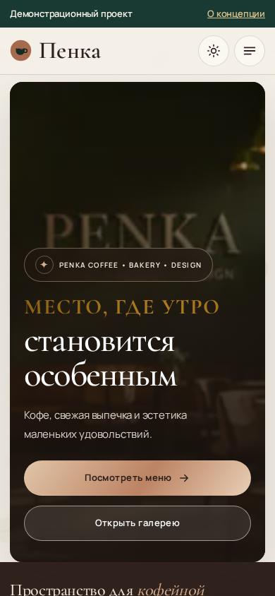

# PENKA — кейс для портфолио

**Проект:** концепция сайта specialty coffee-кофейни  
**Формат:** адаптивный одностраничный сайт  
**Роль:** концепция, UX/UI и фронтенд-разработка  
**Статус:** демонстрационный проект, не действующий бизнес

**[Открыть сайт](https://marcostavar24633-cyber.github.io/Penka/)** · **[Подробный кейс](CASE-STUDY.md)** · **[Исходный код](https://github.com/marcostavar24633-cyber/Penka)**

## Концепция

PENKA — визуальная концепция современной кофейни в эстетике quiet luxury. В основе — тёплая светлая палитра, глубокий лесной зелёный, шампань-золото, выразительная антиква, крупные фотографии и свободная редакционная композиция.

## Что реализовано

- Адаптивный первый экран и навигация для desktop, tablet и mobile.
- Редакционные блоки о кофейной культуре и выпечке.
- Интерактивное меню с пятью категориями.
- Галерея с полноэкранным просмотром и клавиатурной навигацией.
- Светлая и тёмная темы с сохранением выбора.
- Анимации с поддержкой `prefers-reduced-motion`.
- SEO-метаданные, Open Graph, canonical URL, sitemap.xml и robots.txt.
- Оптимизированные WebP-изображения и адаптивные варианты через `srcset`.

## Скриншоты опубликованного сайта

Кадры сделаны автоматически в Chromium непосредственно с опубликованной версии. В репозитории сохранены первый экран и полная страница для каждого формата.

| Desktop · 1440 px | Tablet · 768 px | Mobile · 390 px |
|---|---|---|
|  |  |  |

Полные страницы: [Desktop](.github/portfolio/screenshots/penka-desktop-full.png) · [Tablet](.github/portfolio/screenshots/penka-tablet-full.png) · [Mobile](.github/portfolio/screenshots/penka-mobile-full.png).

## Технологии

Семантический HTML, CSS и vanilla JavaScript. GitHub Pages используется для публикации, GitHub Actions — для автоматических проверок и создания скриншотов. Проект не требует отдельного backend-сервера или базы данных.

## Результаты проверок

В трёх сохранённых Lighthouse-прогонах (запуск [43698951778](https://github.com/marcostavar24633-cyber/Penka/actions/runs/43698951778)) зафиксированы:

| Категория | Результаты |
|---|---:|
| Performance | 84–99 |
| Accessibility | 100 |
| Best Practices | 100 |
| SEO | 100 |

Один из трёх прогонов Performance показал 84, два других — 99. Результаты относятся к конкретным прогонам и могут меняться в зависимости от устройства и сети. Автоматические проверки: [GitHub Actions](https://github.com/marcostavar24633-cyber/Penka/actions).

## Короткое описание

Разработан концепт адаптивного сайта кофейни PENKA: визуальная система, пользовательские сценарии, интерактивное меню, галерея, мобильная навигация, две цветовые темы и базовая SEO-структура. Проект прошёл автоматические проверки адаптивности и доступности.

## Важно

PENKA — вымышленная кофейня и демонстрационный проект. Название, меню и цены условные; фотографии созданы с помощью ИИ. Реальных адреса, телефона, режима работы, отзывов, точки продаж, онлайн-заказа, конверсии и коммерческих результатов нет.
